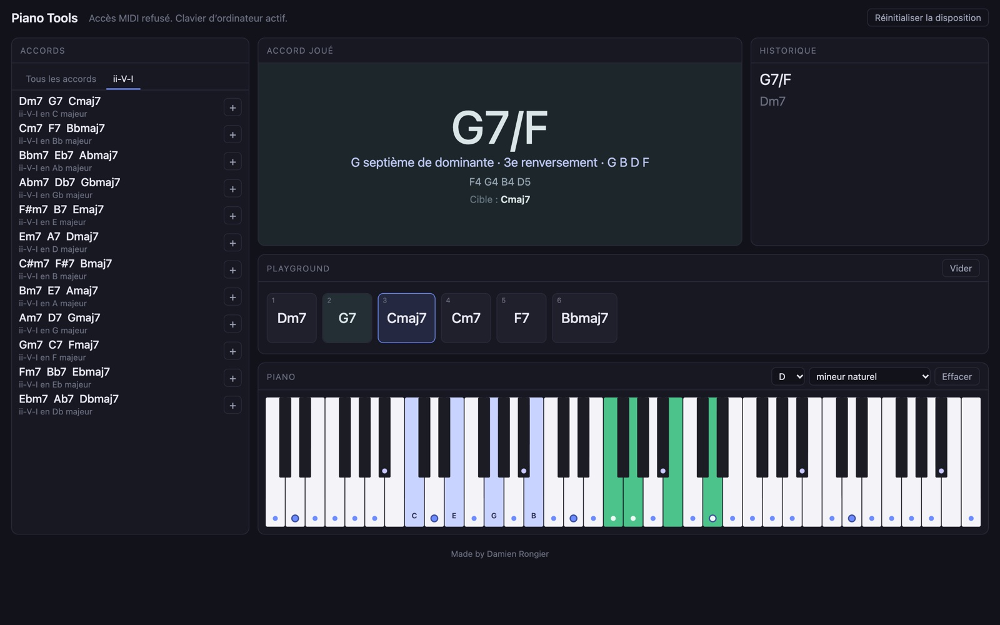
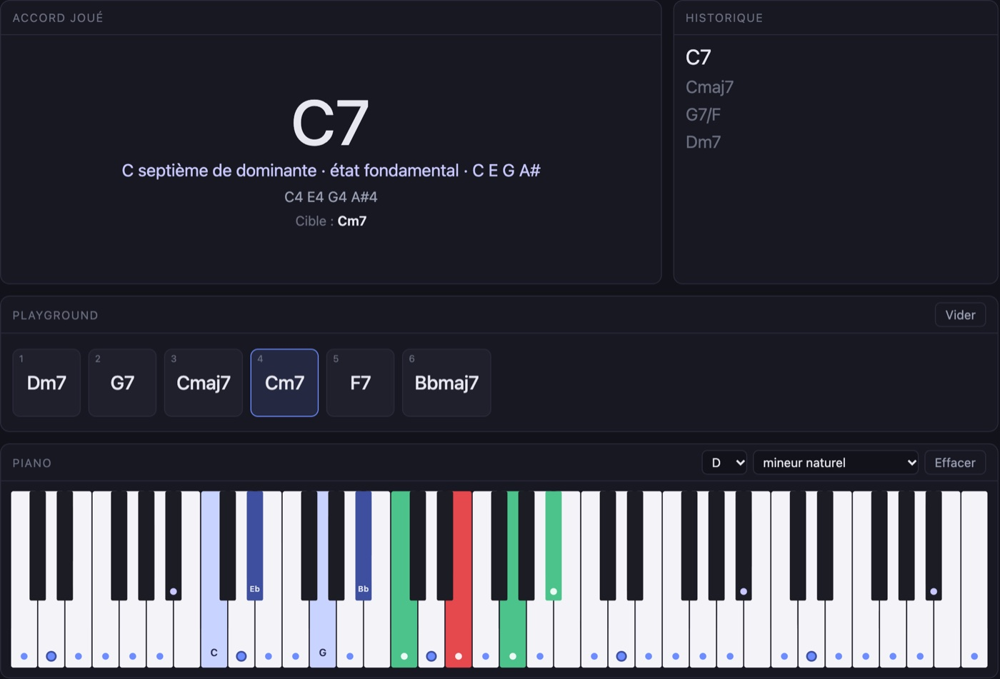
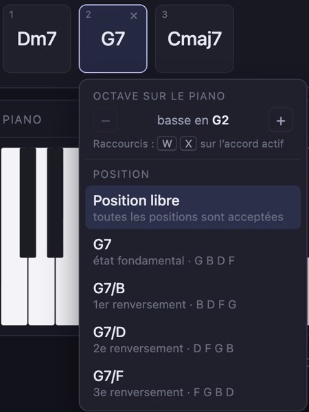

# PianoTools, un tableau de bord pour travailler ses accords au piano

PianoTools est avant tout un projet personnel. Je voulais un outil qui colle exactement à ma façon de travailler le piano : les renversements, les voicings, les ii-V-I dans les douze tonalités, avec un retour immédiat sur ce que je joue. Plutôt que de chercher une appli qui fasse à peu près l'affaire, j'ai construit la mienne.

C'est un tableau de bord qui tourne dans le navigateur : on branche un clavier MIDI, on joue, et l'appli reconnaît l'accord, montre quoi jouer sur un piano à l'écran et fait avancer dans une grille d'accords. Pas de clavier sous la main ? Le clavier de l'ordinateur prend le relais.

Je vais continuer à le faire évoluer au fil de mes besoins, à mesure que ma pratique avance. Et s'il peut servir à d'autres pianistes, tant mieux : il est en ligne et gratuit.


*Le tableau de bord : la bibliothèque d'accords à gauche, l'accord joué, l'historique, le Playground et le piano.*

## Un tableau de bord en modules

L'écran est une grille de modules qu'on déplace et redimensionne à la souris. La disposition est gardée dans le navigateur d'une visite à l'autre.

- **Accord joué** : le dernier accord reconnu en grand, avec sa qualité, son renversement et les notes tenues avec leur octave.
- **Historique** : les accords joués, du plus récent au plus ancien.
- **Accords** : la bibliothèque, soit 12 fondamentales et 20 types d'accords. On cherche par nom (« Am7 », « sus4 », « mineur »), on filtre par fondamentale, et un clic affiche l'accord sur le piano.
- **Playground** : la grille à travailler, dans l'ordre.
- **Piano** : un clavier de C2 à C7 qui montre ce qu'il faut jouer et ce qu'on est en train de jouer.

## Le Playground : jouer pour avancer

Le Playground, c'est le cœur de l'outil. On y glisse des accords depuis la bibliothèque, ou on clique sur « + ». L'onglet ii-V-I propose la cadence dans les douze tonalités majeures, dans l'ordre classique de travail (C, Bb, Ab, Gb, E, D, B, A, G, F, Eb, Db) : un clic, et les trois accords arrivent dans la grille.

L'accord encadré est le prochain à jouer. Quand je le joue juste, la grille passe au suivant, et revient au début après le dernier. Sur le piano, les touches de l'accord cible sont teintées en bleu. Une touche enfoncée devient verte si elle appartient à l'accord, rouge sinon.


*La cible est Cm7, mais je joue C7 : le mi bécarre passe en rouge, les trois autres notes restent vertes.*

Chaque accord de la grille a son menu. On y choisit l'octave où l'accord s'affiche sur le piano (avec les mêmes raccourcis qu'Ableton Live), et surtout sa position. En « position libre », tous les renversements sont acceptés. Si je choisis G7/B, seul le premier renversement compte. C'est ce qui permet de travailler un enchaînement de voicings précis, et pas seulement des noms d'accords.


*Le menu d'un accord : octave sur le piano et choix du renversement.*

Dernier ajout : le premier accord joué fixe une gamme sur sa fondamentale (mineur naturel s'il a une tierce mineure, majeur sinon). Ses notes sont marquées d'un point sur tout le clavier, et un menu permet de changer de mode : dorien, mixolydien, pentatonique, blues, gammes diminuées… Sur les captures, le Dm7 du début a fixé ré mineur naturel.

## Reconnaître un accord, plus subtil qu'il n'y paraît

Sur le papier, reconnaître un accord, c'est comparer un ensemble de notes à une liste d'intervalles. En pratique, ce sont les mains du pianiste qui compliquent tout.

**Les doigts ne tombent jamais en même temps.** Si l'appli réagissait à chaque touche, elle afficherait C, puis C avec E, puis enfin l'accord complet. Le détecteur attend donc que les notes tenues n'aient pas changé pendant 60 ms avant de valider l'accord.

**Relever un doigt n'est pas jouer un accord.** Quand je lâche une note d'un Cmaj7 tenu, il reste C E G, mais je n'ai pas joué un accord de do majeur. Relâcher des touches ne déclenche donc jamais rien à lui seul.

**Le legato a cassé cette règle.** Dans un vrai jeu lié, on pose le nouvel accord avant de lever l'ancien. Pendant un instant, les deux accords sont enfoncés ensemble, et l'appli gardait ce mélange au lieu de suivre le changement. Le correctif : une note relâchée qui appartenait à l'accord précédent, dans les 300 ms qui suivent le dernier appui, compte comme une partie du changement d'accord.

```ts
const legatoRelease =
  pressedAt < this.burstStartMs && nowMs - this.lastPressMs <= this.legatoMs;
```

**Les mêmes notes peuvent former deux accords.** C E G A, c'est C6 ou Am7 selon la basse. Avant que j'ajoute les accords de sixte, un C6 s'affichait comme Am7/C. Aujourd'hui, c'est la basse qui tranche, et elle donne aussi le renversement : E G C s'affiche « C/E ».

Toute cette logique est en TypeScript pur, sans aucune dépendance à l'interface. Le temps est injecté en paramètre plutôt que lu sur l'horloge, ce qui la rend déterministe et facile à tester : 58 tests Vitest couvrent la bibliothèque d'accords, la détection, les gammes et les grilles.

## L'essayer

PianoTools est en ligne sur [drongier.github.io/PianoTools](https://drongier.github.io/PianoTools/) et le code est sur [GitHub](https://github.com/drongier/PianoTools). Le MIDI fonctionne dans Chrome, Edge et Firefox. Safari ne gère pas le MIDI, mais le clavier de l'ordinateur y fonctionne : la rangée du milieu joue les touches blanches à partir du do central, la rangée du dessus les touches noires. Tout reste dans le navigateur, rien n'est envoyé nulle part.
